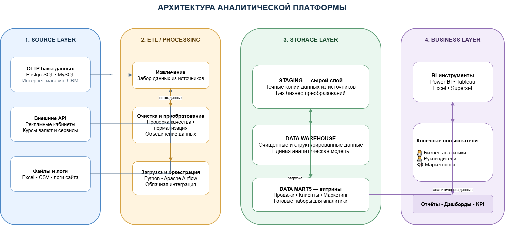
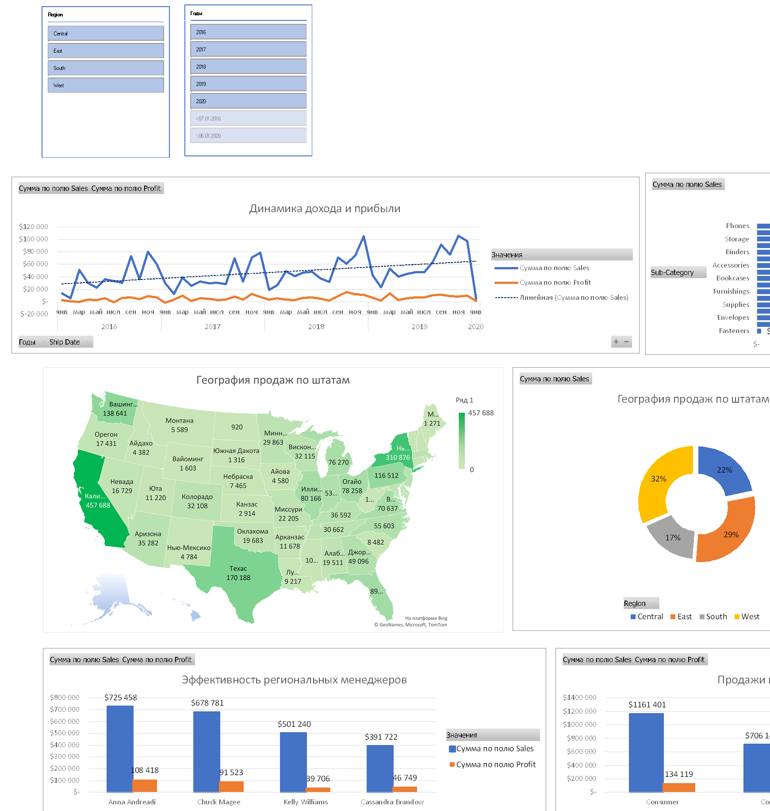

# Домашнее задание модуля 1

## Описание проекта
В рамках первого модуля курса **de101** выполнена практическая работа по проектированию базовой архитектуры аналитического решения и визуализации бизнес-показателей продаж.

## Выполненные задачи
1. **Архитектура решения:** спроектирована схема потоков данных от источников (Source Layer) до уровня бизнес-пользователей (Business Layer) в сервисе draw.io.
2. **Анализ и визуализация данных:** на основе датасета *Sample - Superstore* построен интерактивный дашборд с ключевыми метриками (продажи, прибыль, динамика по регионам и категориям).

## Содержимое папки
* `architecture.png` - схема архитектуры аналитического решения.
* `dashboard.xlsx` - исходный файл с расчетами и дашбордом.

## Визуализация результатов

### Архитектура решения

### Дашборд

### Основные выводы по данным:
1. o
2. o
